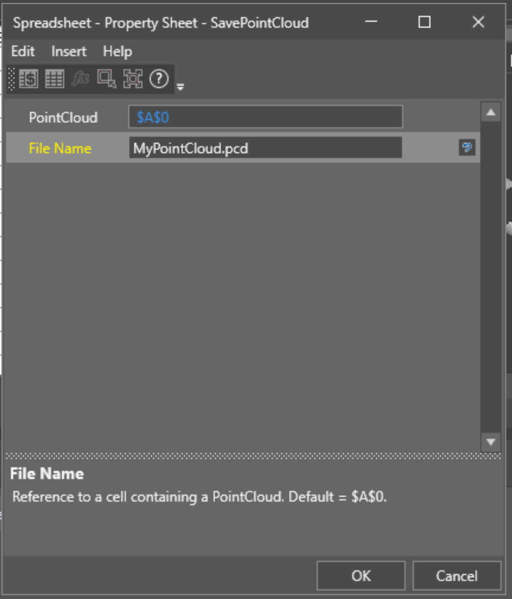
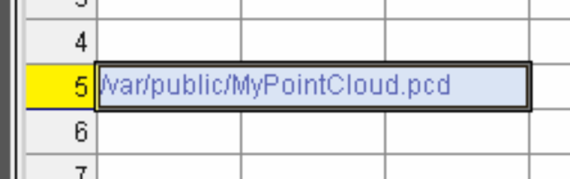

# How to Save PointClouds as .pcd or .ply Formats

> **Source:** [Cognex Support](https://support.cognex.com/en/help-articles/how-to-save-pointclouds-as-pcd-or-ply-formats)  
> **Product:** In-Sight 3D-L4000  
> **Archived:** 2026-11-10

## Question

How do I save the PointCloud from an In-Sight 3D-L4000 as a different format from the default (`.dat`/`.raw`)?

## Answer

1. Open **In-Sight Vision Suite** and connect to the device.

2. In an empty spreadsheet cell, enter the hidden function:

   ```text
   SavePointCloud(
   ```

3. The function dialog box will open:

   

4. Configure the function parameters:

   - **PointCloud:** Link the PointCloud structure to be saved. To save the acquired point cloud, use `$A$0`.
   - **File Name:** Enter the file name followed by the desired extension, for example `MyPointCloud.pcd`.

   Confirm the settings. The spreadsheet cell should then contain a string with the saved file location:

   

5. Go **Online** and send a trigger. The file will be saved locally on the device; this is the only supported save location.

## Related Resources

- [Cognex Add On Profile (AOP) | v1.33](https://support.cognex.com/en/resources/software-firmware/cognex-aop-v1-33/english/27xsG9YKRbWx8-dUFLkpnQ) — Software/Firmware, 2025-06-24
- [TIA Portal Integration Guide And Tag Generator | v1](https://support.cognex.com/en/resources/integration-guide/cognex-profinet-tag-generator/english/FpDOQZZpSaaenlUOCWPgQg) — Integration Guide, 2025-05-12
- [In-Sight Device and Status Icons](https://support.cognex.com/en/help-articles/in-sight-in-sight-device-satus-and-icons) — Help Article, 2025-05-08
