# In-Sight Vision Suite 时间同步调整 SOP

> 日期：2023 年 2 月 14 日

## 兼容相机

- In-Sight D900 系列
- In-Sight 3D-L4000 系列
- IS2800 & IS3800 系列

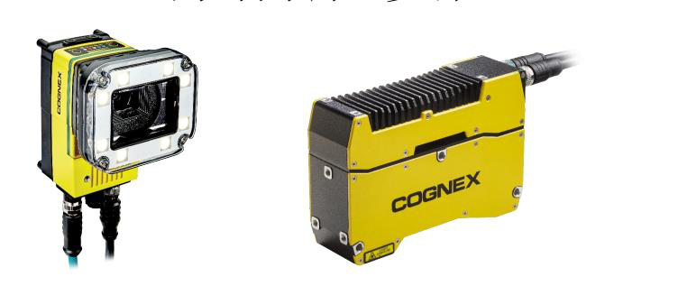

## 设置 NTP 服务器

### 1. 下载 NTP 软件

从以下地址下载并安装最新的 exe 文件：<https://www.meinbergglobal.com/english/sw/ntp.htm>

### 2. 安装 NTP Server

默认下一步安装至指定 NTP Server 地址 `192.168.101.15`，设置系统账户（use system account），完成安装。

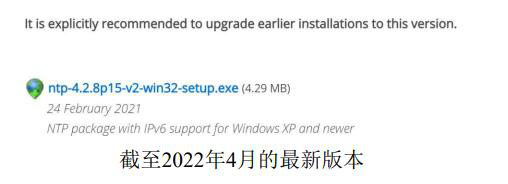

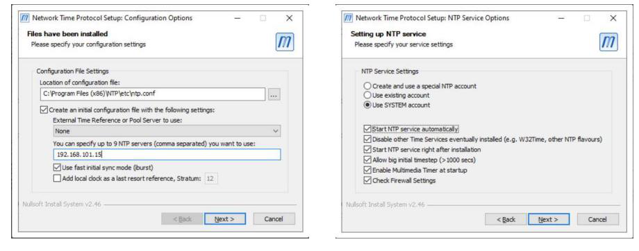

### 3. 以管理员模式打开 "Edit NTP Configuration"

打开路径（示例如下，按实际用户目录调整）：

```
C:\Users\<用户名>\AppData\Roaming\Microsoft\Windows\Start Menu\Programs\Meinberg\Network Time Protocol
```

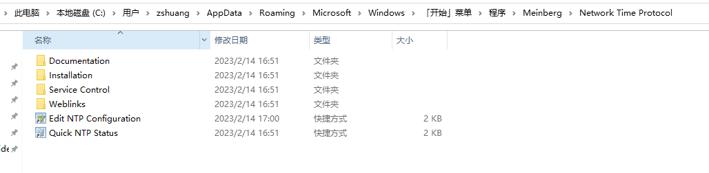

### 4. 替换配置文件内容

将 "Edit NTP Configuration" 中的默认内容**替换前**为以下内容**替换后**：

```
restrict 127.0.0.1
restrict -6 ::1
driftfile "C:\Program Files (x86)\NTP\etc\ntp.drift"
server 127.127.1.0
fudge 127.127.1.0 stratum 12
server 0.pool.ntp.org iburst minpoll 6 maxpoll 7
server 1.pool.ntp.org iburst minpoll 6 maxpoll 7
server 2.pool.ntp.org iburst minpoll 6 maxpoll 7
server 3.pool.ntp.org iburst minpoll 6 maxpoll 7
server pool.ntp.org iburst minpoll 6 maxpoll 7
```

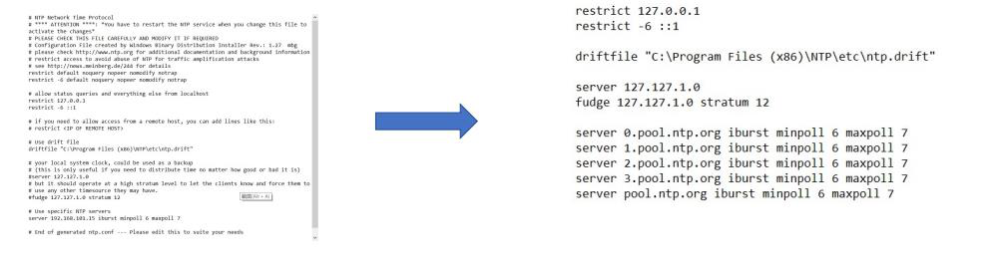

### 5. 以管理员模式运行 Restart NTP Service

打开路径如下所示：

```
C:\Users\<用户名>\AppData\Roaming\Microsoft\Windows\Start Menu\Programs\Meinberg\Network Time Protocol\Service Control
```

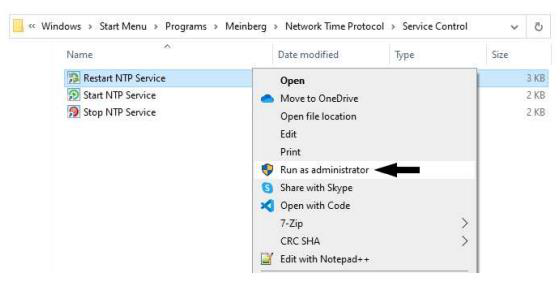

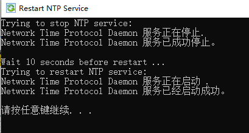

### 6. 打开 Quick NTP Status 确认状态

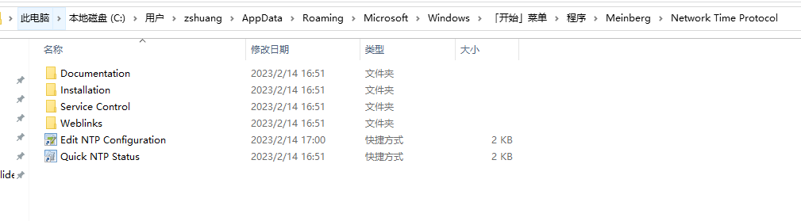

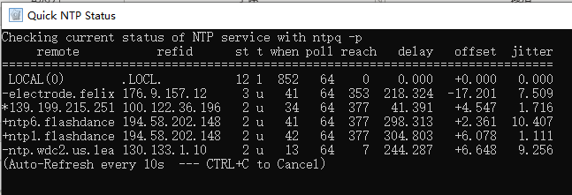

### 7. 查看相机连接的本地网卡地址

通过以太网连接相机到 PC 后，在 CMD 指令窗口输入 `ipconfig` 指令，得到相机连接到本地网卡地址，如下图所示。

### 8. 禁用 Windows 防火墙并关闭杀毒软件

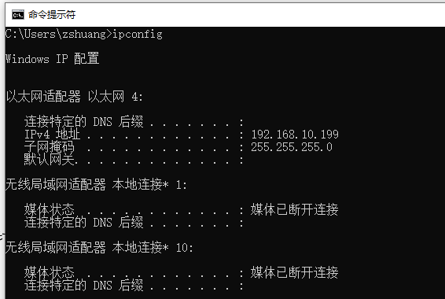

### 9. 在 Vision Suite 中选择相机

打开 Vision Suite，待相机跟 PC 连接好出现在设备列表后，选择 D900 相机，单击"时间设置"。

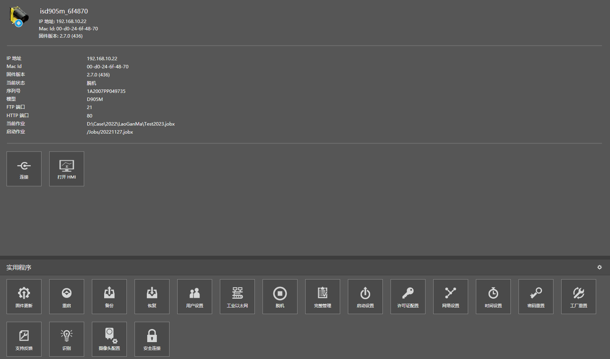

### 10. 配置时间设置

打开时间设置，删除默认 URL，添加相机所连接计算机的 IP 地址（即第 7 步的本地网卡地址）后确定。

- 全部删除默认 URL
- 更改为自己所在时区
- 添加第 7 步所在 IP，即本地网卡地址

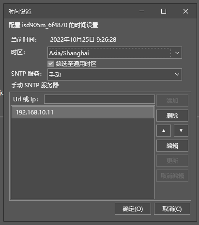

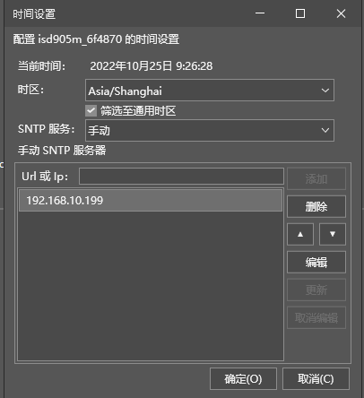

### 11. 重启设备

单击 "OK（确定）"，重新启动设备（重启相机）。

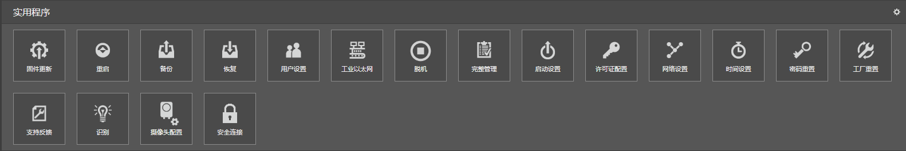

### 12. 验证设置成功

重启完成后，再次打开"时间设置"，设备的"当前时间"跟 OS 的系统时间匹配即表示设置成功。

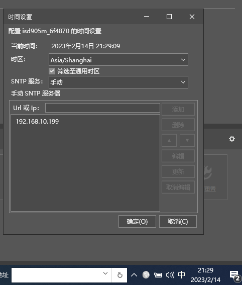
