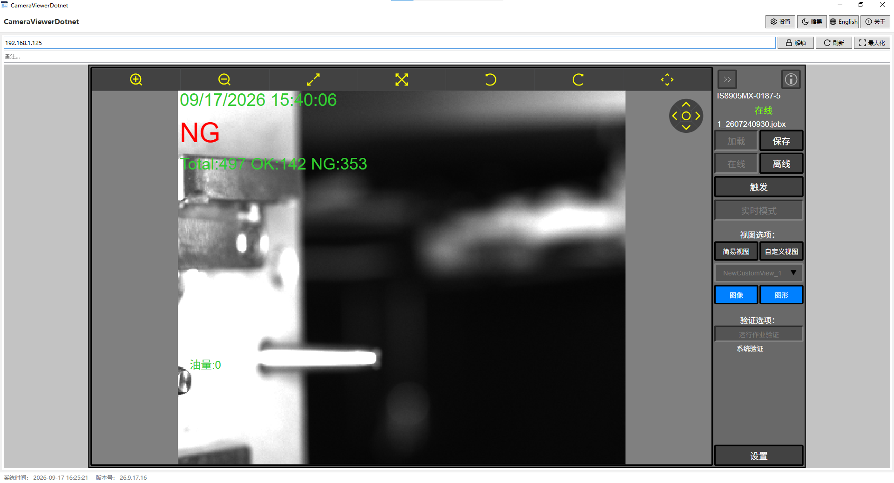

# CameraViewerDotnet

基于 .NET 8 的 WinForms 工业相机监控查看器，复刻自 CameraViewerTauri 核心功能并扩展 CogSocket 子网格、文件中转、存图清理等工业需求。搭配 .NET Framework 4.8 启动器，解决工控机无 .NET 8 运行时无法运行的问题。最终分发为**单个便携式 exe**（内嵌 .NET 8 运行时安装包 + 主程序），不易被杀毒软件误删 DLL。

## 截图



主界面：多路相机网格布局（最大 36 格），Http/GigE 内嵌 WebView2 加载工业相机 HMI 网页，CogSocket 相机按 `identifierCell` + `cellBindings` 绑定拆成 PictureBox 子网格显示拍照原图；顶部 PageHeader + AntdUI.Menu 水平菜单（设置/主题/语言/关于）；底部状态栏显示系统时间与版本号。

## 功能

### 相机接入（三种连接方式）

| 方式 | 说明 | 渲染 |
|---|---|---|
| **Http** | 康耐视 In-Sight、海康等 HTTP HMI 网页相机 | WebView2 内嵌加载 HMI 页面 |
| **CogSocket** | Cognex In-Sight WebSocket（ws://host:port/ws），订阅 `resultChanged` 事件获取 HmiResult | 配置 `subGridCount > 1` + `identifierCell`（拍照标识单元格）+ `cellBindings`（取值→槽位）→ PictureBox 子网格，每次拍照先填 640 宽缩略图、后台再补原图；顶部可切换**产品图 / 叠加图**（叠加图用 WebView2 渲染相机 SVGLayer）；配置不完整时显示提示，**不回退 HTTP HMI** |
| **GigE** | GigE Vision 相机（仅保存序列号 / 曝光配置） | 原生取流未接入；设置页不提供 URL 输入，单元格暂无画面（若沿用旧配置的 `ip` 则按 WebView2 加载） |

### CogSocket 子网格拆分（多面产品场景）

- 相机设置里选 `conn = CogSocket`，输入 IP:Port
- **`identifierCell`**：拍照标识单元格地址（如 `A27` 条件号），其取值 `11` / `21` / `31` / `41` 分别表示第 1~4 次拍照
- **`subGridCount`**：下拉选择 `[1, 2, 4, 6, 8]`（对应 1×1 / 2×1 / 2×2 / 3×2 / 4×2 布局）
- **`cellBindings`**：每个槽位填一个标识取值，值到达即把该次拍照的缩略图填入对应槽位，原图取到后再替换；槽位号与子网格位置一一对应
- 每个槽位左上角显示绑定的标识取值（未绑定时显示 `#槽位号`）
- 仅当 `conn=cogsocket`、`subGridCount>1`、`identifierCell` 非空且至少有一个绑定值时才会启用子网格模式；配置不完整时单元格显示提示，**不回退 HTTP HMI 页面**
- 标识单元格若为数值单元格（`HmiFloatResult`，如 A27 条件号返回 `41.0`），绑定值会先归一化为整数再匹配（`41.0 → 41`）
- 相机一次拍照会连发“新图+旧取值”“旧图+新取值”两个 `resultChanged` 事件；按标识单元格记录最近图像地址，同一张图的滞后事件直接丢弃，避免把上一张图填进新槽位
- 最小槽位对应的取值到达时视为新一轮产品，**先清空所有子网格**，避免新旧产品图片混淆
- 兼容旧配置：若存在旧字段 `cellSubscribe`，首次加载时取其第一个单元格名作为 `identifierCell`
- CogSocket 协议完整复刻自 [CameraCellMonitor](https://github.com/JustSmartAuto/CameraCellMonitor) 实测：`$type`/JSON-RPC + openSession + keepAlive(15s) + **每次 resultChanged 回调末尾发 ready 让相机推下一帧**

### 产品图 / 叠加图切换

- 子网格单元格顶部工具栏新增 **产品图** / **叠加图** 两个按钮（仅 CogSocket 子网格显示），默认产品图，当前模式以主色高亮，语言切换时同步文字
- **产品图**：显示已取回的 640 宽缩略图，原图补取成功后原位替换（PictureBox，`SizeMode=Zoom`）
- **叠加图**：加载时为每个槽位创建一个 WebView2，把该次拍照的图像与其叠加图形放在同一层渲染，开关只切换可见性，避免重复初始化
- 叠加图形来源：`resultChanged` 的 `acqImageView.layers` 中 `$type=SVGLayer` 的 `url`（形如 `/cam0/app/views/{viewId}/layers/{n}/svg`），随该次拍照一起取回（约 4KB）；同层的 `GraphicsLayer`（JSON 版）未使用
- SVG 本身不带 `width/height/viewBox`，其用户坐标就是**采集图像原始像素坐标**（如 2448×2048）；前端注入 `viewBox="0 0 原图宽 原图高"` 与 `preserveAspectRatio="none"`，等比缩放居中，与产品图的 `Zoom` 行为一致
- 缩略图仅用于显示，叠加图的 `viewBox` 始终使用本事件主采集图层的原始宽高，避免图形被裁切或错位
- 新一轮产品到达清空子网格时，同步清空叠加层图像与 SVG；叠加模式下新拍照到达会立即刷新该槽位

### 一台相机一条连接（共享 CogSocket）

- 相同 `IP:Port` 的多个 CameraCell 共用 `CogSocketManager` 中的一条 WebSocket（引用计数，最后一个 Cell 释放后自动关闭）
- 连接按所有订阅者的 `identifierCell` 并集执行 `openSession`；新增标识单元格时自动重连补齐 session
- 每次拍照结果到达后按标识单元格分发给订阅者，各 Cell 再执行 `cellValue → slot`（如 `11 → 槽位 1`）；**先发 640 宽缩略图保证及时显示**，`ready` 后在后台补取原图，成功则原位替换，失败保留缩略图；多个 Cell 共用同一张图时各自持有位图副本
- 顶部刷新按钮只会重建该相机的共享连接，同相机的其他 Cell 会自动恢复接收

### 网格布局

- 1–36 路相机布局（1/2/4/6/9/12/16/20/24/25/30/36）
- 错峰加载：第 i 路相机延时 i×N 秒（默认 10s，可配 0=立即）再加载，避免多路同时打开造成网络风暴
- 每路格子：URL / 备注编辑（失焦或回车即保存）、锁定（锁定后只读）、刷新、最大化/还原；CogSocket 子网格另含产品图/叠加图切换

### 设置窗口（7 个标签页）

| 标签 | 说明 |
|---|---|
| **相机显示** | 相机数量、错峰延时 |
| **相机设置** | 每路卡片：连接方式下拉、URL（Http/CogSocket）或序列号/曝光（GigE）、CogSocket 拍照标识单元格 + subGridCount + 各槽位取值绑定、备注、锁定 |
| **显示设置** | 明亮 / 暗黑 / **BeOS teal chrome** 三种 AntdUI 主题 |
| **软件设置** | 中文 / English，**配置目录切换**（`bootstrap.json` 多开支持） |
| **文件中转** | 复刻 CameraHelperLens：TransformConfig + 完整 DataGridView 部件编辑器（文件夹部件 / 文件名部件，`AntdUI.Collapse` 可折叠）；文件写入稳定等待；FileSystemWatcher 监听；可选立即处理一次 |
| **存图清理** | 复刻 CameraHelperLens：CleanConfig（扫描间隔 / 保留天数 OR 剩余空间阈值 / 清理间隔 / 空目录清理）；可配多个清理策略组合 |
| **JOBX 备份** | FTP/FTPS 相机列表（名称/IP/端口/用户名/密码/备份目录）；一键或全部备份；递归下载 `.jobx`/`.jobx.sig`；环形日志实时显示 |

### 其他

- **HMI 语言跟随**：WebView2 注入 `hmi-i18n.js`（`AddScriptToExecuteOnDocumentCreatedAsync`），在 `/pages/hmi/` 页面做整串文本替换中文化，语言跟随软件界面实时切换
- **关于页面**：程序集 `InformationalVersion` / 功能描述 / 技术栈 / GitHub 仓库链接
- 关闭按钮最小化到系统托盘（右键 显示界面/退出）
- 状态栏显示系统时间与版本号
- **多开支持**：exe 目录 `bootstrap.json` 里写 `{"configDir":"D:\\AnotherDir"}` 即切配置目录；或设置窗口点「复制并重启」一键切换
- 配置 JSON 持久化，exe 旁放置 `portable.txt` 即启用便携模式（配置存 exe 旁 `Configs\`），否则存 `%LOCALAPPDATA%\CameraViewerDotnet\`

## 技术栈

| 部分 | 技术 |
|---|---|
| 主程序 `CameraViewer/` | **.NET 8 WinForms**（无 XAML，纯 C#），AntdUI 2.4.10（Ant Design 风格控件 / BeOS chrome 无边框窗口 / 明暗主题），Microsoft.Web.WebView2，FluentFTP 50.1.0（JOBX 备份 FTP/FTPS），**System.Net.WebSockets + HttpClient**（CogSocket 客户端） |
| 启动器 `CameraViewer.Launcher/` | .NET Framework 4.8（Win10 内置 .NET 4 即可运行），内嵌运行时安装包与主程序 exe 资源 |
| UI 风格 | AntdUI 控件 + VS Code 配色（暗黑 `#1e1e1e`，明亮 `#f0f0f0`）+ **BeOS teal chrome** 主题（窗口细边框 + teal/cream 调色） |

启动器工作流程：检测 `Microsoft.WindowsDesktop.App 8.x`（`dotnet --list-runtimes`，PATH 与 `C:\Program Files\dotnet` 双路探测）→ 缺失则静默安装内嵌的 `windowsdesktop-runtime-8.0.29` → 每次覆盖释放主程序到 `%LOCALAPPDATA%\CameraViewerDotnet\App\` 并启动。

### CogSocket 协议（参考 CameraCellMonitor 实测）

```
WebSocket 握手  ws://host:80/ws（未写端口默认 80；连接失败自动回退 8087）
  ↓ post @/hello (optional, old firmware may reject — non-fatal)
  ↓ detect root: GET cam0/hmi/info → fallback system/info
  ↓ POST {root}/openSession  body={"$type":"HmiSessionInfo","cellNames":[identifierCell:identifierCell]}  → 得到 sid
      （固件只识别范围形式：A21 → "A21:A21"，单地址会返回空 cells）
  ↓ POST {sid}/login  ["admin","",false]  (non-fatal)
  ↓ listen {sid}/resultChanged  ← 一个事件返回完整 HmiResult.cells[]
  ↓ POST {sid}/ready  ← 触发相机推第一帧
  ↓ keepAlive loop 每 15s 发 POST {sid}/keepAlive
  ↓ 收 event → 从 cells[] 找 identifierCell 的取值（11/21/31/41…）
  ↓           → 取图像地址（标识单元格 data / acqImageView.layers[].url / data: base64）
  ↓           → HTTP GET 缩略图 ?sz=640,<等比高>  → 立即解码显示
  ↓ 解码 Bitmap → 按取值绑定的槽位填入 PictureBox.Image (BeginInvoke 切 UI 线程)
  ↓ 先发 POST {sid}/ready  ← 让相机推下一帧（否则只推一帧就停）
  ↓ 后台再 HTTP GET 原图（不带 sz，不缩放）→ 成功则替换缩略图，失败保持缩略图
```

### 文件中转架构（复刻自 CameraHelperLens）

```
ActionQueueWorker    ConcurrentQueue<TransformAction> + Thread + ManualResetEvent 串行消费
TransformAction      等待目录文件写入稳定 → 按配置拆分文件夹/文件名 → 组合目标路径 → File.Move
FileTransformer      FileSystemWatcher 监听 WatchPath → Created 事件 Enqueue
TransformConfig      Name / IsEnable / WatchPath / SourceSpliter / FolderIndex / FileNameIndex /
                     FolderSpliter / FileNameSpliter / FolderPartList / FileNamePartList
TransformPart        PartType(Name|DateTime) / SourceIndex / Format
```

## 构建

需要：.NET SDK 8+、MSBuild（Visual Studio 或 .NET Framework 4.8 自带）。

```bash
dotnet build CameraViewer/CameraViewer.csproj -c Release
```

产物：`CameraViewer/bin/Release/net8.0-windows/CameraViewerDotnet.dll`

完整单文件打包（含运行时安装器）：

```bash
bash build-with-timestamp.sh
```

产物：`dist/CameraViewerDotnet_<yyyyMMddHHmm>.exe`（约 60MB 单文件，直接拷贝到工控机运行）。

## 目录结构

```
CameraViewerDotnet/
├── CameraViewer/                # 主程序
│   ├── App.cs                   # Main + Transit/Cleaner 初始化
│   ├── MainWindow.cs            # 36 路网格 + PageHeader + Menu + 状态栏
│   ├── CameraCell.cs            # WebView2 / CogSocket 子网格 PictureBox + 产品图/叠加图切换（每槽位 WebView2 渲染 SVG）
│   ├── SettingsWindow.cs        # 7 标签页设置窗口（含 DataGridView 部件编辑器）
│   ├── ConfigService.cs         # 模型 + bootstrap.json 多开 + 持久化
│   ├── I18n.cs                  # zh/en 双语
│   ├── ThemeManager.cs          # light/dark/beos 主题
│   ├── AntIcon.cs               # AntdUI 内置 SVG 图标
│   ├── AboutWindow.cs           # 关于页
│   ├── Assets/hmi-i18n.js       # WebView2 注入的 HMI 中文化脚本（EmbeddedResource）
│   ├── CogSocketManager.cs      # 按 IP:Port 共享连接（引用计数 + 按标识单元格分发）
│   ├── CogSocketCamera.cs       # WebSocket 客户端（按 CameraCellMonitor 实测协议，含 CogSocketException）
│   ├── TransformPart.cs         # PartType + TransformPart 模型
│   ├── ActionQueueWorker.cs     # Lens 复刻：串行队列消费
│   ├── TransformAction.cs       # Lens 复刻：等稳定→拆分→Move
│   ├── FileTransformer.cs      # Lens 复刻：FileSystemWatcher 监听
│   ├── ImageCleaner.cs          # Lens 复刻：Timer 扫描 + 空目录清理（CancellationTokenSource）
│   └── JobxBackupService.cs     # FTPS 备份
├── opt-camera-sdk/              # SciCamera SDK（Runtime/ 已 gitignore，本地手动部署）
│   ├── .gitignore               # Runtime/*.dll / *.xml / Samples_CSharp.zip 忽略规则
│   ├── README.md
│   └── SciCamera.Net.dll        # 本地手动拷贝（git ignore 大文件）
├── CameraViewer.Launcher/       # .NET Framework 4.8 启动器
├── reference/                   # CogSocket 协议参考、BeOS 主题素材、图标
├── assets/                      # 截图、图标、内嵌的 .NET 8 运行时安装包
├── .gitignore                   # opt-camera-sdk/Runtime/ + publish/ + 临时备份
└── README.md
```

## 部署注意事项

- **WebView2 运行时**：Http/GigE 模式依赖 WebView2；部分精简版 Win10 工控机可能缺失，首次运行需联网下载，或另行部署 WebView2 离线包
- **启动器内嵌 .NET 8 运行时**：工控机完全离线也能完成运行时安装
- **opt-camera-sdk/Runtime/**：SciCamera SDK 原生 DLL 体积大（约 120MB），不进 git；部署时由安装包或 `.zip` 释放到 `opt-camera-sdk/Runtime/`，`SciCamNative.Configure()` 自动定位
- **CogSocket 连接数**：康耐视 In-Sight 默认最多 5 个 view connection（固件 22.2+）；同一 `IP:Port` 的多个 Cell 共用一条 WebSocket（N 个格子 = 1 个连接），多台相机时仍需控制总数
- **GigE 现状**：原生取流尚未接入；设置页仅保存序列号与曝光，不提供 URL 输入，因此单元格暂无画面（沿用旧 `ip` 时按 WebView2 加载）
- **In-Sight IP 端口**：未写端口默认 80（固件 22.2+ 固定 80）；连接失败自动回退 8087（早期固件）
- **ready 握手**：CogSocket 模式下必须在 `resultChanged` 事件回调末尾发 `POST {sid}/ready`，否则相机只推一帧就停（CameraCellMonitor 实测）
